# 酆都阴司 · AI 智能地府管理系统

> 多 Agent 编排的地府办案系统：阴差受理 → 判官审理 → 阎王复核 → 刑罚执行 → 六道轮回 → 孟婆登记 → 卷宗归档。
> 七个节点、六个 Agent、21 个工具真读写业务库，检查点挂起 / 恢复，全链路降级，双日志可回放。

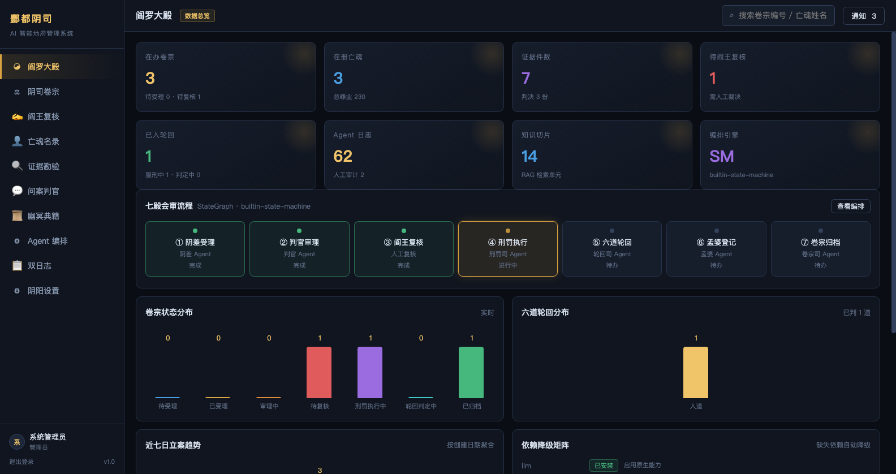

---

## 一、这个系统在做什么

阳寿尽者入酆都，先由**阴差**验明正身、核验卷宗材料是否齐备；材料不齐则发补证通知并**挂起**。材料齐备移交**判官**，判官按善恶簿核算功德与罪业、认定罪名、匹配法条量刑、做风险分级；风险为「高」的重大疑难案件自动生成待办审批单，**挂起**等**阎王**复核。阎王批准后进入**刑罚执行**，刑罚司建立服刑记录并跟踪刑期；刑期届满由**定时巡检**自动续跑，进入**六道轮回**按功德匹配去向，再由**孟婆**忘川登记、饮汤忘前尘，最后**卷宗司**归档并把本案回灌成判例知识，供后续案件检索参考。

整条链路不是写死的顺序调用，而是一张**带条件边的状态图**：三个中断点（材料不全 / 风险高待复核 / 服刑未满）都会把检查点落盘，等外部事件（补证、审批、期满）触发后**从断点处继续**，不重复跑已完成的节点。

## 二、快速开始

### 环境要求

- Python 3.9+（本项目在 **Python 3.14.5** 与 **3.13.12** 上实测通过）
- **默认零第三方依赖**：不需要 fastapi / uvicorn / sqlalchemy / langchain / httpx / apscheduler / numpy，也不需要 Node.js 与前端构建工具
- **可选依赖只有 `langgraph>=1.2,<2`**（见 `requirements.txt`）：装上就由 LangGraph StateGraph 真正驱动办案流程；不装自动降级到内置状态机，功能完全不变

### 启动

日常就两个命令（**默认端口全项目统一为 8899**）：

```bash
./start.sh              # 启动：后台托管，默认 127.0.0.1:8899
./stop.sh               # 停止：不给端口 = 停掉全部受管实例
```

其它用法：

```bash
./start.sh 8900                 # 指定端口
PORT=8900 ./start.sh            # 等价写法
./start.sh --foreground         # 前台运行，Ctrl+C 停止（调试用）
./stop.sh 8900                  # 只停指定端口
HOST=0.0.0.0 ./start.sh         # ⚠️ 对外开放，会打印警告；确认防火墙后再用
cd FastAPI && python3 run.py    # 最原始的方式（同样默认 127.0.0.1:8899）
```

### 克隆仓库后第一次启动

```bash
git clone https://github.com/YOUR_NAME/difu.git difu
cd difu
./start.sh                 # 零依赖直接跑，自动挑装了 langgraph 的解释器
cat .run/credentials.txt   # 首次启动生成的随机强口令（权限 600）
# 浏览器打开 http://127.0.0.1:8899/
./stop.sh                  # 用完停止
```

需要自定义端口、大模型 Key 或演示模式时，复制配置模板再按需解开注释：

```bash
mkdir -p .run && cp .env.example .run/secrets.env && chmod 600 .run/secrets.env
```

`.env.example` 只放空值与默认值，**可以安全进 git**；真值放 `.run/secrets.env`，
它和 `.run/credentials.txt`、`.run/app_secret`、`FastAPI/data/difu.db`、`_backup/`、`.venv/`
一起被 `.gitignore` 拦住，不会进仓库。

> 🔴 **公开仓库注意**：`security.py` 的 `DEMO_PASSWORD_OF` 是课堂演示用的固定弱口令，
> 只在 `DIFU_DEMO_MODE=1` 时生效，源码里看得到。**演示模式只在本机用**，
> 不要同时设 `HOST=0.0.0.0` 或把服务暴露到公网；正常模式（默认）每个账号都是随机 14 位强口令。

### 用 LangGraph 跑（可选，推荐）

`start.sh` 会**自动挑解释器**：优先 `PYTHON` 指定的，其次项目自带 `.venv`、工作区 `.venv`，
挑第一个 `import langgraph` 成功的；都失败才回落到 `python3` 并明确打印「已降级」。
所以一般直接 `./start.sh` 就能吃到 LangGraph，无需记路径。

```bash
# 显式建项目专用 venv（最规范）
python3 -m venv .venv
./.venv/bin/pip install -r requirements.txt
PYTHON=./.venv/bin/python ./start.sh

# 或直接指定任意装了 langgraph 的解释器
PYTHON=/Users/a11/Desktop/waresoft/Python/.venv/bin/python ./start.sh

# 强制切回纯标准库，做教学对比 / 排错
DIFU_FLOW_ENGINE=builtin ./start.sh
```

启动横幅和「设置 → 依赖降级矩阵」会如实显示 `langgraph`（执行中）还是
`builtin-state-machine`（已降级），以及 `DIFU_FLOW_ENGINE` 当前取值。

| `DIFU_FLOW_ENGINE` | 行为 |
| --- | --- |
| `auto`（默认） | 装了 langgraph 就用它；没装自动降级 |
| `langgraph` | 强制用；没装会降级并打印提示，不阻断启动 |
| `builtin` | 强制内置状态机，方便对比两套引擎 |

`difu.sh` 是高级入口（`start.sh` / `stop.sh` 内部转给它），每个端口各自一份 pid / 日志：

```bash
./difu.sh start   [端口]        # 后台启动（等 HTTP 就绪才返回）
./difu.sh stop    [端口]        # 停止
./difu.sh restart [端口]        # 重启（不给端口时自动跟随正在运行的实例）
./difu.sh status  [端口]        # 进程 / 端口 / HTTP / 时长
./difu.sh log     [端口] [-f]   # 查看日志，-f 持续跟随
```

端口被别的程序占着时会直接拒绝（**绝不抢端口**），也不会去杀不是自己起的进程；
两个 `start` 同时执行时用端口锁串行化。`stop.sh` 发 SIGTERM，后端会走 `finally`
做 SQLite WAL checkpoint 再释放端口（不再是硬杀）。

启动时自动建表、灌种子数据（角色 / 辖区 / 六个账号 / 七类字典 / 4 条模型配置 / 12 篇典籍 / 3 名演示亡魂），并**在空库上自动跑出三条演示卷宗**，随后打印横幅：

```
==============================================================
  地府阴差管理系统 · 后端已启动
  监听地址 : 127.0.0.1:8899（仅本机）
  服务地址 : http://127.0.0.1:8899/
  数据库   : sqlite → .../FastAPI/data/difu.db
  流程引擎 : builtin-state-machine（如实报告）
  登录口令 : .run/credentials.txt
==============================================================
```

浏览器打开 `http://127.0.0.1:8899/` 即是完整前端（后端静态托管 `frontVue3/`）。

### 登录账号与口令

系统预置 6 个账号，**账号名固定**（见下表），但**口令每台机器都不一样**：首次启动
为每个账号生成随机 14 位强口令，只写在本机 `.run/credentials.txt`（权限 600，
已被 `.gitignore` 忽略）。

> 🔴 **README / 源码 / 登录页里都不写明文口令。** 这个仓库要上传 GitHub，
> 明文口令一旦 commit 就永久留在 git 历史里，事后很难抹掉。**别把本机口令贴进
> README、issue、commit 或聊天记录**；给别人演示时让对方 clone 后自己 `./start.sh`，
> 他拿到的是属于他自己那台机器的口令。

取口令（文件格式 `账号 口令 # 角色`）：

```bash
cat .run/credentials.txt                           # 6 个账号一次看全
awk '$1=="admin"{print $2}' .run/credentials.txt   # 只取 admin 的口令
```

| 账号 | 角色 | 数据可见范围 |
| --- | --- | --- |
| `admin` | 管理员 | 全部（`*`），重置演示数据也仅它能做 |
| `yanwang` | 阎王 | 全部业务，含审批裁决 |
| `panguan` | 判官 | 自己承办或**未指派**（judge_id=0）的卷宗 |
| `yinchai` | 阴差 | 受理 / 建卷 / 传证，**无审批权、无删除权** |
| `lunhui` | 轮回官 | 轮回判定相关 |
| `chenghuang` | 城隍 | 仅本辖区（东岳·J3）卷宗 |

#### 课堂演示：固定弱口令只对本机「全新空库」有效

`DIFU_DEMO_MODE=1` 只影响 **seed 建账号那一刻**：空库在此模式下用 `admin123` /
`123456`，默认模式用随机强口令。它**不会把已轮换过的强口令改回弱口令** ——
`security.py` 的 `rotate_initial_passwords()` 在演示模式直接 return，`seed.py` 又是
幂等的，已有账号不会被重建。实测（2026-11-07，全在隔离库上跑，未动真实库）：

| 场景 | `admin` / `admin123` |
| --- | --- |
| 现有库副本 + `DIFU_DEMO_MODE=1` | **401 拒绝** |
| 全新空库 + `DIFU_DEMO_MODE=1` | **200 成功** |

想用简单口令，只能拿一个**全新空库**（代价：没有现有卷宗数据）。下面这条命令实测跑通：

```bash
mkdir -p /tmp/difu_demo/run
DIFU_DEMO_MODE=1 SQLITE_PATH=/tmp/difu_demo/difu.db DIFU_RUN_DIR=/tmp/difu_demo/run ./start.sh 8900
# 浏览器开 http://127.0.0.1:8900/ ，admin / admin123
DIFU_RUN_DIR=/tmp/difu_demo/run ./stop.sh 8900
```

演示弱口令源码里就有（`security.py` 的 `DEMO_PASSWORD_OF`），**仅限本机**：
勿设 `HOST=0.0.0.0`，勿把服务暴露到公网。

### 安全基线（2026-11-05 加固）

| 项 | 以前 | 现在 |
| --- | --- | --- |
| token 签名密钥 | 源码里写死 `difu-secret-key-please-change`，可离线伪造管理员 | 首次启动随机生成，存 `.run/app_secret`（600），源码无默认值 |
| 口令 | 固定全局盐 + 5/6 个账号共用 `123456` | 每账号随机盐 PBKDF2；弱口令首次启动自动轮换 |
| 大模型 Key | 明文存 `model_config.api_key`，接口还回显头尾 | 统一存 `.run/secrets.env`，数据库字段清空，`/api/models` 一个字符都不回显 |
| 监听 / CORS | `0.0.0.0` + `Access-Control-Allow-Origin: *` | `127.0.0.1` + 同源，跨域要显式配白名单 |
| 登出 | 只记日志，token 照样能用 | jti 写服务端黑名单（落盘），真失效 |
| token 传参 | 支持 `?token=`，会进访问日志 | 只认 `Authorization: Bearer` |
| 写接口越权 | 只有列表做行级过滤，阴差能删任意卷宗、城隍能改他人通知 | 统一 `_guard_case()` 校验 + 启用 `case:delete` + 通知/会话加归属条件 |
| 异常回显 | 畸形参数回显 Python 原生报错 | 只回业务中文提示，细节进服务端日志 |
| 重置演示数据 | 任意 `dict:write` 一键清 16 张表 | 仅 admin + `confirm=RESET` + 删除前自动备份 + 事务 |
| 前端 XSS | 弹窗标题/正文拼 `innerHTML` | 改 `textContent` 纯文本渲染 |

> ⚠️ 若你的数据库里曾存过真实 API Key，**请到模型平台轮换一次**（旧 Key 出现过明文）。
> 本次加固会把遗留 Key 自动搬到 `.run/secrets.env` 并清空数据库字段。

### 三分钟走一遍完整流程

1. 用 `.run/credentials.txt` 里的 `admin` 口令登录（「阴阳设置 → 演示数据」的**重置全部数据**会重建三条演示卷宗，执行前自动备份到 `FastAPI/backups/`；空库首次启动已自动建好，此步可跳过）。
2. 「阎罗大殿」看总览：在办 3 卷、待复核 1 单、七殿流程高亮在「④刑罚执行」。
3. 「阴司卷宗」点任一行的**详情**：看亡魂善恶、七殿流转、检查点停在哪、Agent 逐步推理。
4. 「阎王复核」对钱氏案点**去裁决** → 批准 → 卷宗自动从 `reviewing` 续跑到 `executing`（刀山狱 2920 天）。
5. 回「阴司卷宗」对该卷点**模拟刑期届满** → 六道轮回 → 孟婆登记 → 归档，判「地狱道」，判例回灌知识库。
6. 「问案判官」问「盗伐林木者依《酆都法典》当判何罪？」，看 SSE 流式回复与 RAG 命中溯源。

## 三、截图

| 页面 | 说明 |
| --- | --- |
|  | **阎罗大殿**：8 项 KPI、七殿会审流程条、卷宗状态分布、六道轮回分布、近七日立案趋势、依赖降级矩阵 |
| 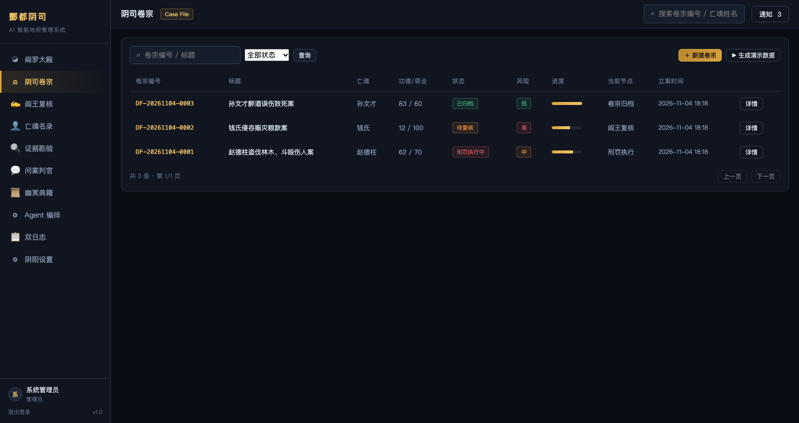 | **阴司卷宗**：状态筛选 / 关键词检索 / 分页，状态与风险分级用彩色 tag |
| 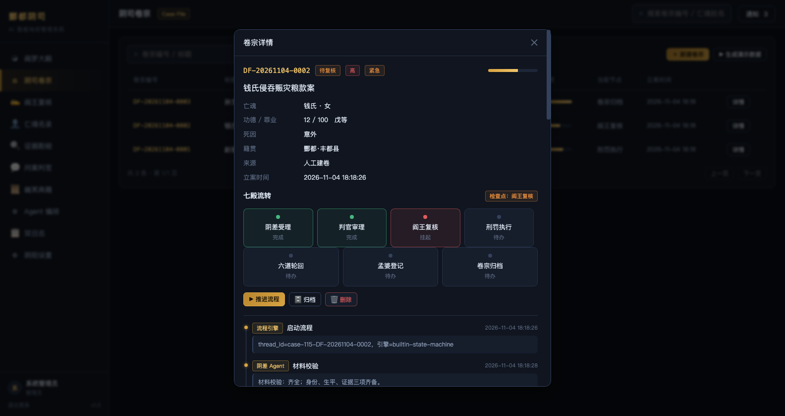 | **卷宗详情**：七殿流转（挂起节点标红）、检查点、判决 / 服刑 / 轮回卡片、证据、批注、Agent 推理日志、审批记录 |
| 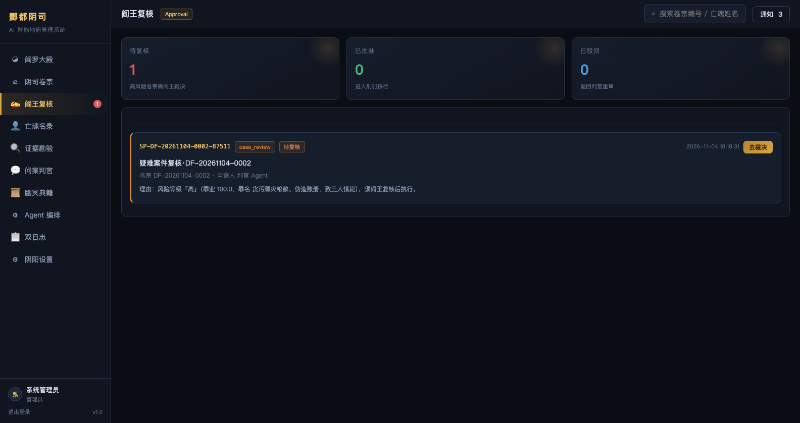 | **阎王复核**：待复核 / 已批准 / 已驳回三态，批准与驳回双路径 |
| 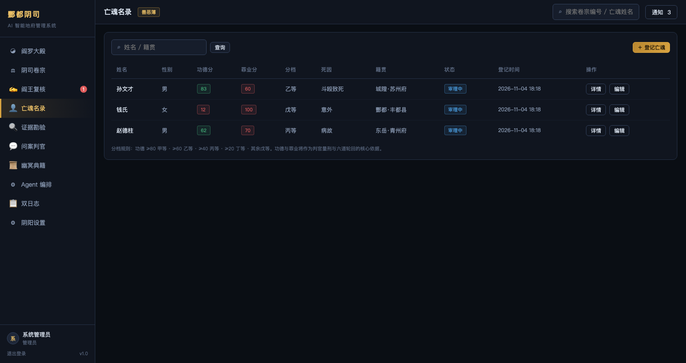 | **亡魂名录**：善恶簿功德 / 罪业与甲乙丙丁戊分档 |
| 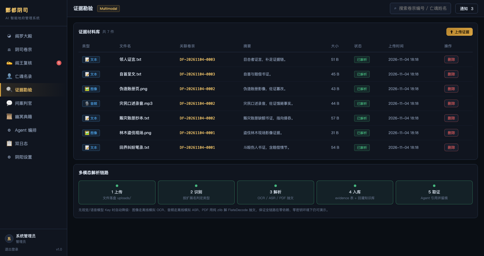 | **证据勘验**：拖拽上传，自动 OCR / ASR / 抽文，解析后回灌证据库 |
| 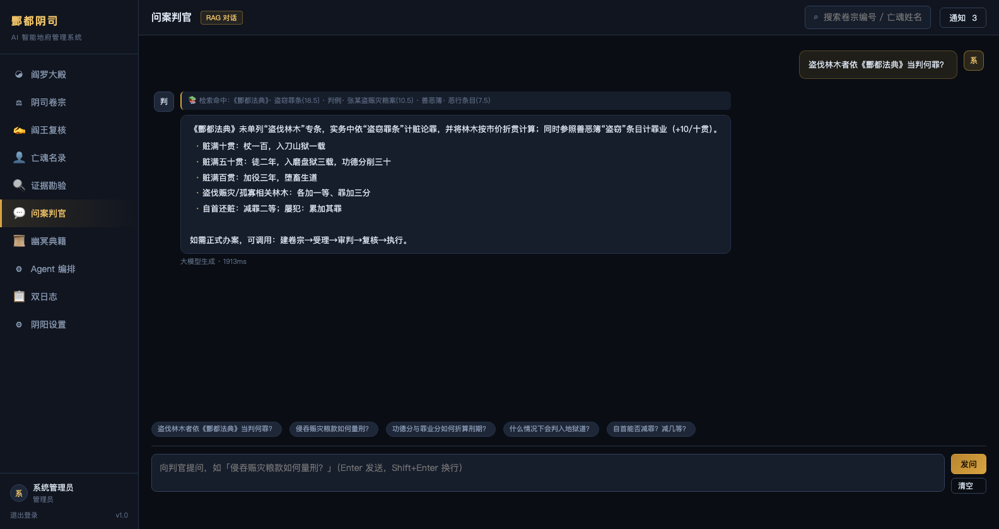 | **问案判官**：SSE 流式 RAG 问答，命中溯源带评分 |
| 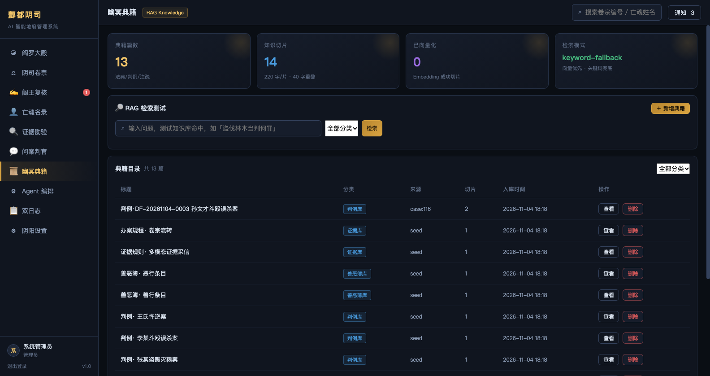 | **幽冥典籍**：知识库统计、RAG 检索测试、典籍增删查 |
| 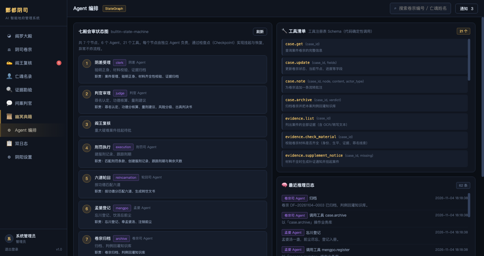 | **Agent 编排**：七节点状态图 + 条件边 + 21 个工具清单 + 最近推理日志 |
| 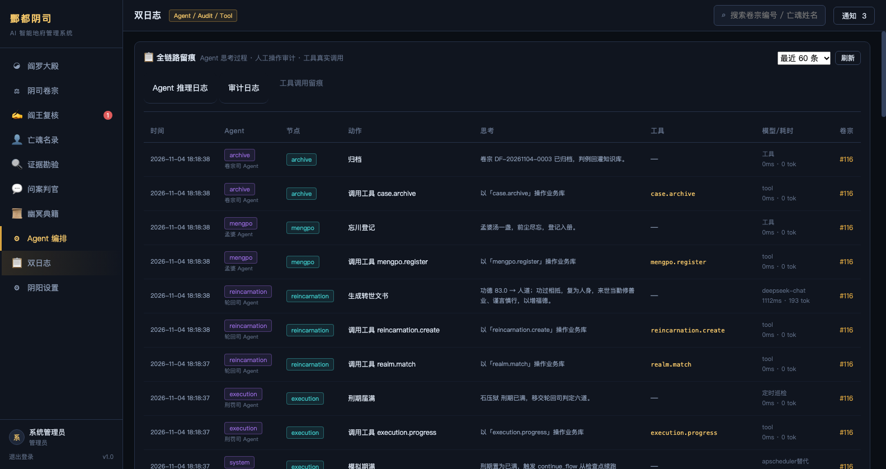 | **双日志**：Agent 推理日志 / 审计日志 / 工具调用留痕三视图 |
| 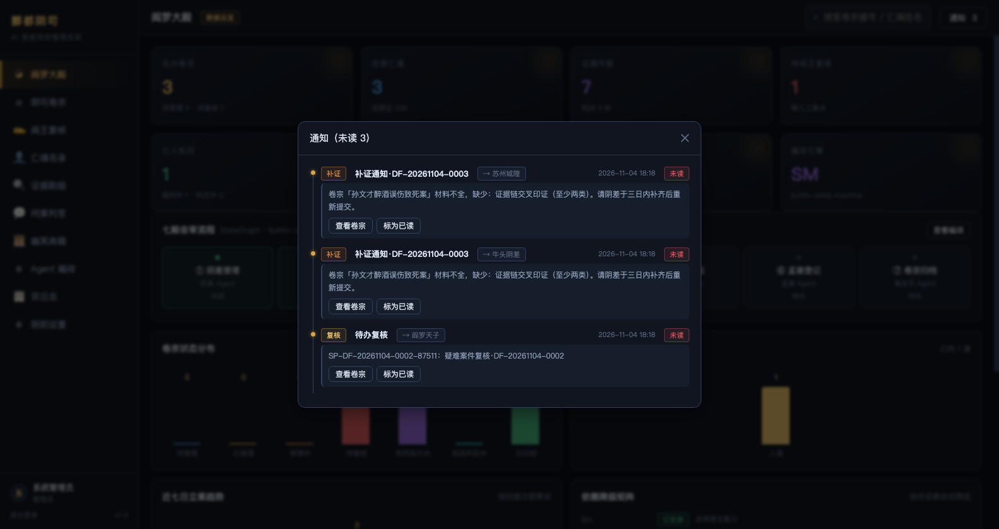 | **通知面板**：顶栏「通知」弹出，补证 / 复核两类通知，标注收件人，可跳卷宗、可标已读 |
| 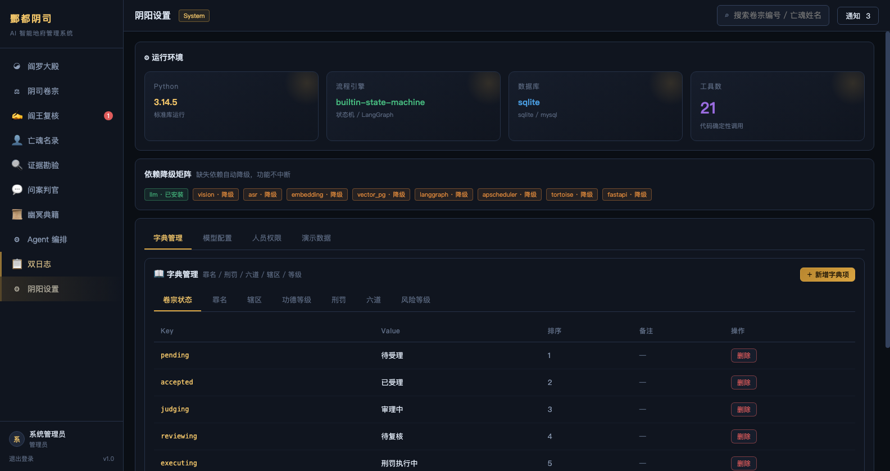 | **阴阳设置**：运行环境、降级矩阵、字典管理、模型配置、人员权限、演示数据 |

## 四、技术选型：默认零依赖 + 可选真框架

最初这台机器上 fastapi / uvicorn / sqlalchemy / pydantic / langgraph / langchain / httpx / apscheduler / numpy **全都没装**，node / pnpm 也没有，而且**没有外网**。于是做了一个刻意的选择：**把「框架能力」自己实现一遍，把「三方能力」做成可选 + 降级**。

2026-11-05 起补上了最后一环：**LangGraph 从「摆设」变成真正接管执行的引擎**（详见下一节）。但「不装也能跑」这条底线没变——`langgraph` 是唯一可选依赖，缺了就自动降级到内置状态机，业务语义逐项对齐（实测 24 项对比 0 差异）。

| 常规做法 | 本项目的做法 | 收益 |
| --- | --- | --- |
| FastAPI + uvicorn | 标准库 `ThreadingHTTPServer` + 自写 `Router` / `Request` / `Response` | 同样的装饰器路由、路径参数、query / JSON / multipart 解析、依赖注入式鉴权、SSE 流式、静态托管 |
| SQLAlchemy / Tortoise | 标准库 `sqlite3` + 自写 DAL（`query/insert/update/delete/tx`） | 无 ORM 心智负担，SQL 即所见；预留 MySQL 适配（`?` → `%s`） |
| LangGraph StateGraph | **装了就真用**（`langgraph_engine.py`）；没装走自写状态机 | 两条执行路径共用同一个 `_execute_step()`，写库行为完全一致；`engine_name()` 如实报告实际引擎 |
| MemorySaver | LangGraph 的 checkpointer 记执行轨迹 + `checkpoint` 表做业务持久化 | 进程重启后仍能从检查点恢复（纯 MemorySaver 做不到），且检查点与业务数据同库，删卷宗不会留孤儿 |
| APScheduler | daemon 线程定时 `tick()` | 60s 巡检服刑期满的卷宗并自动续跑 |
| PGVector / Embedding | 三级降级：PGVector → 本地向量余弦 → 关键词 + 中文二元组 IDF 打分 | 无 Key 也能检索，且中文短查询命中率可接受 |
| LLM Function Calling | 工具注册表 + 规则兜底 | 有 Key 走大模型**决策**，无 Key 走规则引擎；工具由代码**确定性调用**（模型只出决策 JSON，不自选工具），保证同一卷宗重跑可复现、日志可回放 |
| Vue3 + Vite | 手写响应式 + 虚拟 DOM（`core.js`）+ 十个页面 | 无构建步骤，改完刷新即生效；diff 保证输入框光标不丢 |

**降级不是「假装能用」**：每一项降级都有一份真实可用的替身实现，页面「依赖降级矩阵」会明确标出当前哪些能力走的是内置兜底。

### 4.1 LangGraph 是怎么接进来的

改造前这里有个典型的「假接入」：代码里 `import langgraph` 成功、`build_langgraph()` 也定义了一份图，但 `run_flow` / `continue_flow` / `start_case` 里 **0 处调用**，顶栏却谎报在用。修完谎报后变成永远返回 `builtin-state-machine`——诚实了，但框架还是没用上。

现在的结构：

```
HTTP /api/cases/{id}/run
   └─ graph.run_flow()                ← 分派器（前置护栏两路径共用）
        ├─ langgraph_engine.run()     ← 默认：StateGraph 驱动节点 + 条件边
        │    └─ graph._execute_step() ← 共用业务执行 + 写库副作用
        └─ graph._run_flow_builtin()  ← 降级：原来那份纯标准库循环
             └─ graph._execute_step() ← 同一个函数，行为逐字一致
        └─ graph.save_checkpoint()    ← 两路径都落项目 checkpoint 表
```

- **状态**：`FlowState(TypedDict)` + `Annotated reducer`，不再用 `StateGraph(dict)`。
- **入口**：`START` 直接挂条件边，按 `entry` 跳到任意节点，对应 `run_flow(start=...)`（审批通过后从 `execution` 起跑、驳回后从 `judge` 起跑）。
- **条件边**：`halt → END`，否则按 `goto` 跳；与内置 `_next_of()` 语义一致。
- **人工闸门**：`review` 节点没有 Agent，进入即挂起等阎王批，不能靠「推进流程」跳过。
- **持久化**：项目自己的 `checkpoint` 表是业务状态权威源，`review_decision` / `review_round` / `halt_node` 等自定义字段靠 `payload` 通道原样带过（避免被 StateGraph 静默丢弃）。

三个踩过的坑（都在代码注释里标注了）：

| 坑 | 症状 | 解法 |
| --- | --- | --- |
| `StateGraph(dict)` | `get_graph()` 报 `InvalidUpdateError`、`invoke()` 报 `Can receive only one value per step` | 改 `TypedDict` + 每字段 reducer |
| 未声明字段被静默丢弃 | 审批决策丢失、`KeyError` 难排查 | 用 `payload` 通道背住整个业务 state |
| `recursion_limit` 写成 `invoke()` kwarg | 静默失效，回落到默认 10007，循环跑飞 | 必须放 `config={"recursion_limit": ...}` |

同一个 `thread_id` 重复 `invoke` 会让 `steps` 累加，所以 `steps` 用覆盖型 reducer、由节点自己维护列表，每次以历史步骤为起点，`_this_run_steps()` 只切片返回本次新增。

## 五、目录结构

```
地府阴差管理系统/
├── start.sh                    ⭐ 启动（自动挑装了 langgraph 的解释器）
├── stop.sh                     ⭐ 停止（不带端口 = 停掉全部受管实例）
├── requirements.txt            唯一可选依赖：langgraph>=1.2,<2
├── .env.example                配置模板（空值，可进 git；真值放 .run/secrets.env）
├── LICENSE                     MIT
├── .gitignore                  运行时 / 密钥 / 数据库 / 备份 / venv 一律不进 git
├── difu.sh                     高级入口：start / stop / restart / status / log
├── .run/                       pid、日志、app_secret、secrets.env、credentials.txt（600，不进 git）
├── FastAPI/                    后端（纯标准库）
│   ├── run.py                  启动入口：python3 run.py（默认 127.0.0.1:8899）
│   ├── backups/                /api/demo/reset 执行前的自动数据库备份
│   ├── app/
│   │   ├── config.py           全部配置走环境变量 + 降级矩阵
│   │   ├── schema.py           21 张表 DDL + 索引
│   │   ├── db.py               sqlite3 DAL（query/insert/update/delete/tx/reset）
│   │   ├── security.py         RBAC + 令牌 + 行级过滤 + audit_log / agent_log
│   │   ├── seed.py             角色/辖区/账号/字典/典籍/演示亡魂 幂等种子
│   │   ├── demo.py             三条演示卷宗（分别停在不同阶段）
│   │   ├── server.py           ThreadingHTTPServer + SSE + multipart + 静态托管
│   │   ├── agents/
│   │   │   ├── llm.py          大模型客户端（chat / chat_stream / embed / test）
│   │   │   ├── rag.py          切片 / 关键词 / 向量三级检索 + 判例回灌
│   │   │   ├── multimodal.py   图像 OCR、语音 ASR、PDF 抽文、文本解析
│   │   │   ├── tools.py        21 个业务工具注册表（自动留痕 tool_call）
│   │   │   ├── crew.py         六个 Agent（受理/判官/刑罚/轮回/孟婆/卷宗）
│   │   │   ├── graph.py        引擎分派 + 共用节点执行 + 检查点 + 审批裁决 + 降级循环
│   │   │   ├── langgraph_engine.py  ⭐ StateGraph 真执行引擎（TypedDict/条件边/checkpointer）
│   │   │   ├── scheduler.py    定时巡检：服刑期满自动续跑
│   │   │   └── chat.py         判官问答（RAG 上下文 + SSE 流式）
│   │   └── api/
│   │       ├── base.py         零依赖 Web 框架（Router/Request/Response/SSE/静态）
│   │       ├── auth.py         登录 / 登出 / 会话 / 总览 / 趋势 / 系统信息
│   │       └── routes.py       44 条业务路由（卷宗/亡魂/证据/判决/审批/知识库/日志…）
│   ├── data/                   difu.db + vector_store.json
│   └── uploads/                证据原文件
├── frontVue3/                  前端（无构建，后端直接托管）
│   ├── index.html
│   ├── css/main.css            暗色幽冥主题
│   └── js/
│       ├── core.js             响应式 + 虚拟 DOM（h / reactive / mount / toDom）
│       ├── api.js              全部接口封装 + SSE 手工分帧
│       ├── ui.js               组件库（tag / modal / toast / 图表 / 分页…）
│       ├── app.js              路由 / 侧边栏 / 登录 / 深链
│       └── pages/              十个页面
└── docs/
    ├── ARCHITECTURE.md         架构说明（分层职责 / 状态机 / 降级矩阵 / 踩坑记录）
    └── screenshots/            十二张实机截图
```

运行时文件都在 `.run/`：`difu-<端口>.pid` 记进程号与启动时间，`difu-<端口>.log` 是后端输出（含每次启动/停止的时间戳分隔行），`difu-<端口>.lock/` 是启动锁（持有者已退出时会被识别为残留并自动清掉）。

规模：后端 **4480 行 / 22 个 .py**（`app/` 4457 行 + `run.py` 23 行），前端 **3475 行**（css 395 + core 302 + api 223 + ui 234 + app 305 + pages 2016）+ `index.html` 41 行。

想读代码，从 [docs/ARCHITECTURE.md](docs/ARCHITECTURE.md) 开始：它讲了分层边界、状态机的三个挂起点、
每条降级路径的兜底实现，以及开发过程中踩过的具体坑（表名撞 SQL 保留字、检查点错位、vdom diff 的假值判断等）。

## 六、状态机与检查点（核心机制）

```
                     ┌──────────────────────────────┐
                     │  材料不全 → 挂起，发补证通知  │
                     ▼                              │
 ①阴差受理 ──材料齐备──▶ ②判官审理 ──风险低/中──▶ ④刑罚执行 ──刑期届满──▶ ⑤六道轮回 ──▶ ⑥孟婆登记 ──▶ ⑦卷宗归档 ──▶ END
                          │  风险高                    ▲                                       
                          ▼                            │阎王批准                              
                       ③阎王复核 ────────────────────┘                                        
                          │阎王驳回 → 退回②重审                                               
```

| 节点 | 承接 Agent | 进度 | 主要动作 |
| --- | --- | --- | --- |
| `intake` 阴差受理 | 阴差 Agent | 20 | 验明正身、材料齐全性校验、证据归档；不齐则发补证通知并挂起 |
| `judge` 判官审理 | 判官 Agent | 45 | 功德 / 罪业核算、罪名认定、法条检索、量刑、风险分级、出判决书 |
| `review` 阎王复核 | 人工复核 | 60 | 风险高时生成待办审批单并挂起，等阎王批准或驳回 |
| `execution` 刑罚执行 | 刑罚司 Agent | 70 | 匹配刑罚条款、建服刑记录、跟踪剩余天数 |
| `reincarnation` 六道轮回 | 轮回司 Agent | 85 | 按功德匹配六道、生成转世文书 |
| `mengpo` 孟婆登记 | 孟婆 Agent | 92 | 忘川登记、饮汤忘前尘 |
| `archive` 卷宗归档 | 卷宗司 Agent | 100 | 归档并回灌判例知识库 |

**检查点**：`thread_id = case-{id}-{case_no}`，`save_checkpoint(case, state, status)` 先写进程内 `_MEMORY`，再镜像到 `checkpoint` 表（有行则 update，否则 insert）。状态有三种：`running` / `interrupted`（挂起）/ `ended`。

三个中断点与恢复入口：

| 中断场景 | 挂起时检查点停在 | 恢复触发 | 恢复入口 |
| --- | --- | --- | --- |
| 材料不全 | `intake` | 补证后手动推进 | `continue_flow(case_id)` |
| 风险高待复核 | `review`（不是 `judge`） | 阎王裁决 | `decide_approval(id, approve, opinion, approver)` |
| 服刑未满 | `execution` | 刑期届满 / 定时巡检 | `scheduler.tick()` → `continue_flow(force=True)` |

两个易错的实现细节（都踩过坑）：

1. **判官因风险高挂起时，检查点必须停在 `review` 而不是 `judge`**。否则恢复时又从判官节点跑一遍，会重复出判决书与审批单。代码里是 `state["node"] = "review" if current == "judge" else current`。
2. **`continue_flow` 的 `review → execution` 映射**：检查点停在 `review` 时，审批通过后应直接从 `execution` 开始跑，而不是先跑 `review`（`review` 节点本身是「进入即挂起」的语义）。

## 七、六个 Agent 与 21 个工具

**Agent 基类**统一了「先想、再动手、全程留痕」的模式：

```python
decision, meta = self.think(prompt, context, schema_hint)   # 有 LLM Key 走大模型，否则返回 {} 
result = self.use(ctx, "tool.name", **kwargs)              # 调工具 + 写 agent_log
self.log(case_id, action, thought, meta, tool_name=..., tool_input=..., tool_output=...)
```

| Agent | 职责 |
| --- | --- |
| 阴差 Agent | 案件受理、验明正身、材料齐全性校验、证据归档 |
| 判官 Agent | 罪名认定、功德分核算、量刑建议、风险分级、出具判决书 |
| 刑罚司 Agent | 匹配刑罚条款、创建服刑记录、跟踪刑期与剩余天数 |
| 轮回司 Agent | 按功德分匹配六道、生成转世文书 |
| 孟婆 Agent | 忘川登记、奉孟婆汤、注销前尘 |
| 卷宗司 Agent | 卷宗归档、判例回灌知识库 |

**21 个工具**（`tools.py` 的 `TOOLS` 注册表，每个都真读写业务库，且 `call()` 会往 `tool_call` 表留痕）：

| 分类 | 工具 |
| --- | --- |
| 卷宗 | `case.get` `case.update` `case.note` `case.archive` |
| 亡魂 | `deceased.get` `deceased.update_merit` |
| 证据 | `evidence.list` `evidence.check_material` `evidence.supplement_notice` |
| 律法 | `knowledge.search` `law.match_crime` `law.match_penalty` `merit.calculate` |
| 判决与执行 | `judgment.create` `execution.create` `execution.progress` |
| 轮回 | `realm.match` `reincarnation.create` `mengpo.register` |
| 协同 | `approval.create` `notification.send` |

**关键业务阈值**（规则引擎的硬约束，改这里就是改判案尺度）：

- **量刑** `law.match_penalty`：基准天数 盗窃 365 / 伤人 180 / 欺诈 540 / 诽谤 365 / 邪淫 720 / 逃税 730 / 纵火 1095 / 贪污 1825 / 忤逆 1825 / 杀人 3285；`ratio = clamp(sin_score / 60, 0.05, 1.6)`，实际天数 `= int(base_days * ratio)`；**罪业为 0 或判不出显著罪名时直接免刑**（`sentence_days = 0`，不建服刑记录，直接进轮回判定）。
- **罪名匹配** `law.match_crime`：罪名原词命中 +4.0，别名按权重累加（侵吞 3.0 / 不孝 3.0 / 致死 2.5 / 杀 2.5 / 盗伐 2.5 / 斗殴 2.0 …），**总分须 ≥ 2.0 才定罪**（只出现「账册」这类 1.0 的弱别名不定罪）；兜底 OCR/ASR 的「模拟文本」会先被正则整段剔除，不参与量刑。
- **刑罚匹配**：盗窃→刀山狱、杀人→血池狱、欺诈/忤逆/诽谤→拔舌狱、贪污/纵火→油锅狱、邪淫→铜柱狱、逃税→磨盘狱、伤人→石压狱。
- **功德核算** `merit.calculate`：善行 救 +20 / 孝 +30 / 施教 +15 / 济贫 +10 / 施粥 +8 / 修桥 +5 / 厚葬 +5 / 赔偿 +5 / 自首 +8；恶行 杀 +100 / 毙 +100 / 致死 +60 / 忤逆 +60 / 纵火 +50 / 贪污·侵吞 +40 / 伤·斗殴 +30 / 邪淫 +25 / 伪造 +20 / 盗 +10。**同一关键词只记一次**（避免重复计数虚高）。**计算以善恶簿的 `merit_score` / `sin_score` 为基线**（`max(基线, 证据推算值)`），所以证据里没提到的善恶不会被抹掉；**自首则 `sin *= 0.5`**，且这一步在取基线之后执行（否则减罪会被基线覆盖）。
- **六道判定** `realm.match`：功德 ≥90 天道；≥70 人道；≥50 且罪业 ≥50 → 阿修罗道，否则人道；≥30 畜生道；罪业 ≥90 地狱道；其余饿鬼道。

## 八、数据库（21 张表）

| 分组 | 表 |
| --- | --- |
| 组织与权限 | `role` `jurisdiction` `user` |
| 办案主链 | `deceased` `case_file` `case_note` `evidence` `judgment` `execution` `reincarnation` `approval` |
| 日志与协同 | `agent_log` `audit_log` `notification` `tool_call` |
| 知识与对话 | `knowledge_doc` `knowledge_chunk` `chat_message` |
| 配置与运行时 | `model_config` `sys_dict` `checkpoint` |

> 表名用 `case_file` 而非 `case`：`case` 是 SQL 保留字，`CREATE TABLE case` 会直接报 `near "case": syntax error`。

**双日志**分工明确：

- `audit_log`：**人**做了什么（登录、审批、增删改、定时巡检），字段 `user_name / action / target_type / target_id / detail / ip / source`，`source` 区分 `human` / `scheduler` / `agent` / `system`。
- `agent_log`：**Agent 怎么想的**（`thought`）、调了哪个工具（`tool_name`）、入参与结果（`tool_input` / `tool_output`）、用的什么模型、耗时、tokens。
- `tool_call`：工具调用的原始留痕（`args` / `result` / `success` / `duration_ms`），供「双日志」页第三视图溯源。

## 九、API 一览（51 条）

统一响应 `{code: 0, msg, data}`，失败时 `code != 0`；鉴权用 `Authorization: Bearer <token>`。

| 分组 | 路由 |
| --- | --- |
| 会话 | `POST /api/auth/login` `POST /api/auth/logout` `GET /api/auth/me` |
| 总览 | `GET /api/dashboard/overview` `GET /api/dashboard/series` `GET /api/dashboard/system` |
| 卷宗 | `GET /api/cases` `POST /api/cases` `GET /api/cases/{id}` `POST /api/cases/{id}/run` `POST /api/cases/{id}/expire` `POST /api/cases/{id}/archive` `POST /api/cases/{id}/note` `DELETE /api/cases/{id}` |
| 亡魂 | `GET /api/deceased` `POST /api/deceased` `GET /api/deceased/{id}` `PUT /api/deceased/{id}` |
| 证据 | `GET /api/evidence` `POST /api/evidence/upload` `DELETE /api/evidence/{id}` |
| 结果 | `GET /api/judgments` `GET /api/executions` `GET /api/reincarnations` |
| 审批 | `GET /api/approvals` `POST /api/approvals/{id}/decide` |
| 知识库 | `GET /api/knowledge` `POST /api/knowledge` `DELETE /api/knowledge/{id}` `GET /api/knowledge/search` |
| Agent | `GET /api/agents/graph` `GET /api/agents/tools` `GET /api/agents/logs` |
| 日志 | `GET /api/audit/logs` `GET /api/tools/calls` |
| 通知 | `GET /api/notifications` `POST /api/notifications/{id}/read` |
| 字典 | `GET /api/dict` `POST /api/dict` `DELETE /api/dict/{id}` |
| 模型 | `GET /api/models` `PUT /api/models/{id}` `POST /api/models/{id}/activate` `POST /api/models/{id}/test` |
| 人员 | `GET /api/users` |
| 对话 | `POST /api/chat/stream` `GET /api/chat/history` `POST /api/chat/case` |
| 演示 | `POST /api/demo/seed` `POST /api/demo/build` `POST /api/demo/reset` |

`POST /api/chat/stream` 返回 SSE，帧格式：

```
event: meta
data: {"rag_hits": [...], "mode": "rule-engine"}

event: delta
data: {"text": "依据知识库检索结果答复："}

event: done
data: {"latency_ms": 887, "length": 512}
```

## 十、接入真实大模型（可选）

系统默认零 Key 运行（规则引擎兜底），**判决、量刑、六道判定全在本地算完**，无网络也能跑通全链路。要接真模型，两条路：

**A. 环境变量**

```bash
export LLM_API_KEY=sk-xxx
export LLM_BASE_URL=https://api.deepseek.com/v1
export LLM_MODEL=deepseek-chat
python3 run.py
```

**B. 页面配置（推荐，可热切换）**

登录后进「阴阳设置 → 模型配置」，按用途（text / vision / asr / embedding）点**编辑**，填 Base URL、模型名、API Key，保存后点**测试**验证连通，再点**启用**。

- 保存即生效，**不用重启服务**；`API Key` 留空表示沿用原有 Key（前端拿到的是 `sk-AB12****wxyz` 这种脱敏串，不会把真 Key 覆盖成星号）。
- 配置存 `model_config` 表，`is_active=1` 且 `has_key` 的那条生效；接口返回时 Key 已脱敏为 `前6 + **** + 后4`。
- 顶栏与「运行环境」的降级矩阵会**跟着变**：`llm · 已安装` 表示库里已有可用 Key，`llm · 降级` 表示还在走规则引擎。

其余可选环境变量：`VISION_API_KEY` / `VISION_BASE_URL` / `VISION_MODEL`（图像 OCR）、`ASR_API_KEY` / `ASR_BASE_URL`（语音转写）、`EMBEDDING_API_KEY` / `EMBEDDING_BASE_URL` / `EMBEDDING_MODEL`（向量化）、`DB_ENGINE=mysql` + `MYSQL_*`（MySQL，未装 `pymysql` 自动回落 sqlite）、`SCHEDULER_INTERVAL`（巡检间隔，默认 60s）、`APP_SECRET` / `TOKEN_TTL`（令牌签名密钥与有效期）。

### 接真模型实测踩到的四个坑（都已修好，记录在此避免重复踩）

| 现象 | 根因 | 修法 |
| --- | --- | --- |
| 配了 `LLM_API_KEY` 却仍显示「降级」 | `active_config()` 只查 `model_config` 表，库里 Key 为空就直接返回 `None`，环境变量根本没被读 | 加 `_env_defaults()`：库里 Key 为空时用环境变量补，库里完全没配则临时拼一份（不写库） |
| `POST /api/models/1/test` 报 `CERTIFICATE_VERIFY_FAILED`，而 `curl` 一切正常 | Python 3.14 的 `etc/openssl/` 是空目录，`ssl.get_default_verify_paths()` 拿到 `cafile=None` | `_ssl_context()` 按 `SSL_CERT_FILE` → `/etc/ssl/cert.pem` → … 顺序 `load_verify_locations`，实测 `cert_store_stats()` 从 0 变 `x509_ca: 128` |
| 连点三次「推进流程」，每次缺的证据都不一样，永远补不完 | 阴差 Agent 让模型单方面决定 `complete`/`missing`，模型每轮都能发明新缺失项 | 补证门槛以**规则检查**为准（`check["complete"]`），模型的意见只写进「补充建议」日志 |
| 卷宗审批单还是 `pending`，卷宗却已进了刑罚执行 | `continue_flow` 里 `nxt = {"review": "execution"}.get(node, node)`，点「推进流程」直接跨过复核 | `review` 节点先查 `approval WHERE case_id=? AND status='pending'`，有待办就原地挂起并提示「请由阎王批准或驳回后再推进」 |

判决一致性也在这轮实测里修了五处：模型自拟的复合罪名（「谋夺田产、伪造地契、逼死一家三口」）在罪名字典里查不到 → `law.match_penalty` 加别名表按最长匹配；罪名改判后刑期按新罪名**重算**（原来沿用规则的「无咎→免刑」，出现「罪业 90 却免刑」）；判词里抄了「初判免刑」而刑期已是几百天 → 有刑期就以天数为准重写判词；风险等级触顶（罪业 ≥80）时在理由里显式补一句「风险强制升为高」而不是悄悄改字段；服刑牢狱按罪名映射而不是从判词里猜。

还有一处是后来才发现的：判词里的**数字**没人管。模型会把上下文里的规则基准抄进判词（「沸油煎熬涤荡罪业二千九百二十日」），而落库的 `sentence_days` 是按最终罪名重算的另一份，卷宗上就出现「判词 2920 日 / 刑期 3285 天」。`crew.py` 的 `_align_desc_days(desc, days, fallback)` 现在会把判词与判决理由里「N 日 / N 天」的数字改到与落库刑期一致，并保持原文的数字风格（中文判词写中文数字：3285 → 三千二百八十五）；判词写着「免刑」却又算出了刑期、或判词为空时，整段换成规则给的刑罚条款——这类已经自相矛盾，改数字救不回来。「三日后」「七日内」「11月4日」这类时间词与 30 以下的数字不碰（刑期最小也有 9 天，不会误伤）。同一轮还修了牢狱取值：判词常并科好几个牢狱（「沸油煎熬…期满转刀山狱三载、血池狱三载」），只取第一个出现的会把贪污案的主刑记成次要的刀山狱，现在以按罪名映射出的主刑为准；而判词又常只写刑罚描述不写狱名（「巨石压身，偿其重负」就是石压狱），所以匹配时狱名与描述两种写法都认。

## 十一、RAG 的三级降级

| 级别 | 触发条件 | 实现 |
| --- | --- | --- |
| ① PGVector | 配了 `PGVECTOR_DSN` 且装了 `psycopg2` | 向量库近邻检索 |
| ② 本地向量 | 配了 `EMBEDDING_API_KEY` | 调 `/embeddings` 取向量，落盘 `data/vector_store.json`，余弦相似度排序 |
| ③ 关键词兜底 | 以上都没有（默认） | 中文**二元组 IDF 加权**：完整词命中标题 ×6、命中正文 ×3，二元组命中 `0.4 + 0.9 × idf`；并带同义词扩展（盗伐→盗窃/林木、侵吞→贪污、赈灾→粮款、误伤致死→杀人、斗殴→伤人、不孝→忤逆…） |

实测效果（第 ③ 级）：

| 查询 | Top1 命中 | 分数 |
| --- | --- | --- |
| 盗伐林木者依《酆都法典》当判何罪？ | 《酆都法典》· 盗窃罪条 | 18.5 |
| 侵吞赈灾粮款 | 《酆都法典》· 贪污罪条 | 15.61 |
| 忤逆不孝 | 判例· 王氏忤逆案 | 13.58 |
| 功德核算 | 《酆都法典》· 功德核算通则 | 23.79 |

切片规则：每片 220 字、重叠 40 字，句读优先断句。**判例回灌**：`case.archive` 归档时把整案摘要 `rag.ingest_text(..., category="判例库", source=f"case:{cid}")` 写回知识库，所以每办完一案知识库就多一篇判例（演示基线里 12 篇种子 + 1 篇回灌 = 13 篇）。

## 十二、多模态证据

`POST /api/evidence/upload`（multipart，字段名 `file` 或 `files` 都接受）→ 存 `uploads/` → `multimodal.parse_file()` → 写 `evidence` 表 → 回灌「证据库」→ 记 `agent_log`。

| 类型 | 有 Key 时 | 无 Key 时（兜底） |
| --- | --- | --- |
| 图像 | 视觉模型 base64 data-url 调用，返回 OCR 文本 | 生成结构化占位描述（尺寸 / 类型 / 待人工核验） |
| 音频 | ASR 接口转写 | 返回模拟转写文本 |
| PDF | 纯标准库 `zlib` 解 FlateDecode + 正则提取 `Tj` / `TJ` 字符串 | 同左（本就不依赖三方库） |
| 文本 | 直接读 | 直接读 |

## 十三、前端实现要点

零构建的「Vue3 风格」：`core.js` 里 302 行实现 `h()` 建 vnode、`reactive()` 用 Proxy 深响应、`mount()` 走 vdom diff 重渲染。

几个关键决定：

1. **`value` 相同就不写 DOM** —— 保住输入框光标与焦点，否则每帧重渲染都会把光标顶到行尾。
2. **`toDom(vnode)` 把 vnode 转真实 DOM** —— 弹窗容器是原生 DOM（`#modal-root`），`appendChild` 一个 vnode 对象会直接抛 `parameter 1 is not of type 'Node'`。
3. **patchChildren 用 `=== null/undefined` 判空，不用 falsy** —— 空字符串 `''` 是合法文本节点，用 falsy 判断会把「空串 → 文字」当成新增子节点，导致同一段文字渲染两遍。
4. **删除多余节点要从后往前删** —— 正序 `remove()` 会让 `childNodes[i]` 下标错位，残留上一页的卡片。
5. **深链 `#cases?case=<id>` 要先 capture 再 go** —— `go()` 会把 hash 改写为 `#route`，query 会被丢掉。

## 十四、已知限制

- **无外网、无三方包**：所有能力都跑在内置替身实现上，AI 部分是规则引擎而非真模型；接入 Key 后自动切换到真模型路径。
- **单机 sqlite**：并发写靠 `ThreadingHTTPServer` + 每请求独立连接 + 显式 `commit`；高并发场景应换 MySQL（`DB_ENGINE=mysql`，代码已做 `?`→`%s` 与 `AUTOINCREMENT`→`AUTO_INCREMENT` 适配）。
- **检查点是「进程内 + 表镜像」双写**：进程重启后靠表恢复，但 `_MEMORY` 会被清空，首次读取多一次 DB 查询。
- **前端是自研极简框架**：只覆盖本项目用到的能力（列表 / 表单 / 弹窗 / 图表 / SSE），不适合当通用框架用。
- **演示数据重置需要二次确认**：`POST /api/demo/reset` 仅管理员可调用，请求体必须带 `{"confirm":"RESET"}`，执行前自动把数据库备份到 `FastAPI/backups/`，删除过程走事务。只清业务表，**保留** `user` / `role` / `jurisdiction` / `sys_dict` / `model_config`。

## 十五、排错

| 现象 | 原因 | 处理 |
| --- | --- | --- |
| `near "case": syntax error` | 表名撞 SQL 保留字 | 已全量改为 `case_file`，勿再改回 |
| 插入成功但 `count` 为 0 | sqlite3 默认隐式事务未提交 | `db.execute()` 已无条件 `conn.commit()` |
| 重置后所有请求 401 | 旧版 `reset_db` 连 `user` 表一起清 | 已改为只清 `BUSINESS_TABLES` |
| 弹窗空白且控制台报 `appendChild ... not of type 'Node'` | 把 vnode 当真实 DOM 用 | 用 `Mini.toDom(vnode)` 转换 |
| 切页后残留上一页卡片 | patchChildren 删除下标错位 | 已改为从后往前删 |
| 判官挂起后恢复出现两份判决 | 检查点停在 `judge` 而非 `review` | 已修正挂起点 |
| 上传报 `'str' object has no attribute 'name'` | `parse_file()` 需要 `Path` | 已改传 `Path(path)` |

**常用调试命令**

```bash
# 登录取 token（口令从本机凭据文件读，别写死在命令里）
PASS=$(awk '$1=="admin"{print $2}' .run/credentials.txt)
TOKEN=$(curl --noproxy '*' -s -X POST http://127.0.0.1:8899/api/auth/login \
  -H 'Content-Type: application/json' \
  -d "{\"username\":\"admin\",\"password\":\"$PASS\"}" | python3 -c 'import sys,json;print(json.load(sys.stdin)["data"]["token"])')

# 重建演示数据（仅 admin + 二次确认 + 自动备份）
curl --noproxy '*' -s -X POST http://127.0.0.1:8899/api/demo/reset \
  -H "Authorization: Bearer $TOKEN" -H 'Content-Type: application/json' \
  -d '{"confirm":"RESET"}'

# 手动推进卷宗 / 模拟刑满
curl --noproxy '*' -s -X POST http://127.0.0.1:8899/api/cases/1/run    -H "Authorization: Bearer $TOKEN"
curl --noproxy '*' -s -X POST http://127.0.0.1:8899/api/cases/1/expire -H "Authorization: Bearer $TOKEN"

# 启停 / 查进程
./start.sh && ./stop.sh
lsof -nP -iTCP:8899 -sTCP:LISTEN
```

## 十六、交付清单

- [x] 后端 21 张表、21 个工具、6 个 Agent、7 节点状态机（含检查点挂起 / 恢复 / 审批裁决 / 定时巡检）
- [x] 51 条 REST 路由 + SSE 流式对话 + multipart 上传 + 静态托管
- [x] RBAC 六角色 + 行级数据过滤 + 双日志（audit_log / agent_log / tool_call）
- [x] RAG 三级降级（PGVector / 本地向量 / 中文二元组 IDF）+ 判例回灌
- [x] 多模态解析（图像 OCR / 语音 ASR / PDF 抽文 / 文本）
- [x] 前端十个页面 + 登录页，零构建、零依赖
- [x] 端到端实测：三条演示卷宗分别停在「服刑中 / 待复核 / 已归档」，审批 → 续跑 → 刑满 → 轮回 → 归档全链路跑通
- [x] 十二张实机截图（`docs/screenshots/`）
- [x] 一键启停拆成 `./start.sh` / `./stop.sh` 两个命令（底层 `difu.sh` 支持多实例、端口锁、端口指纹、优雅退出）
- [x] 接真模型可用：页面「阴阳设置 → 模型配置」点编辑填 Key 即写入 `.run/secrets.env` 并立即生效，无需重启（实测 DeepSeek）
- [x] 安全加固：随机签名密钥 / 随机盐口令 / 真登出 / 行级权限统一 / XSS 修复 / 异常脱敏 / CORS 白名单 / 重置备份（见「安全基线」）
